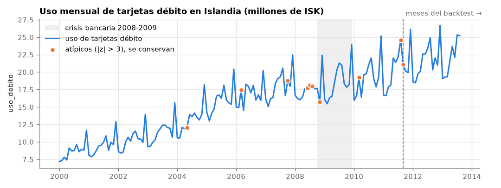
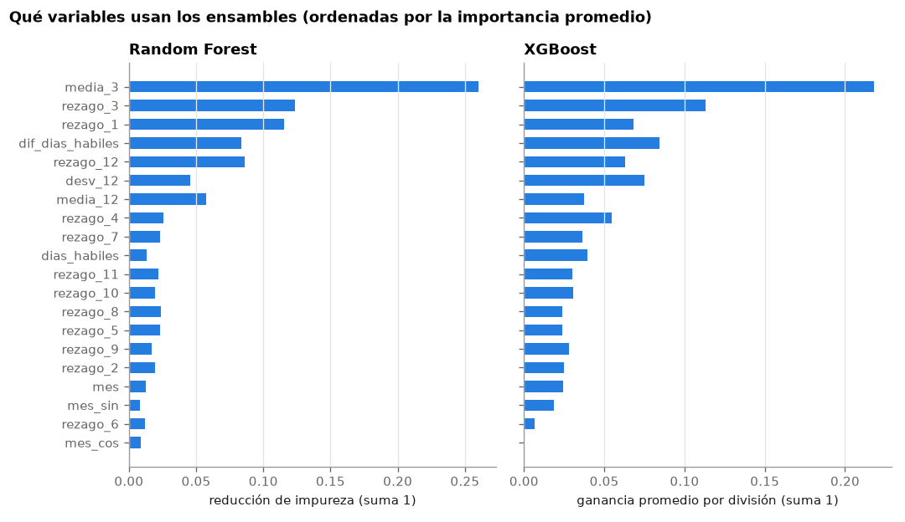

# Informe del miniproyecto 2

Llene cada sección reemplazando los marcadores `{{...}}`, sin quitar las
secciones. Las cifras salen de lo que imprime `python miniproyecto.py` y las
figuras son las que ese guion deja en `figuras/`. Las fórmulas van en LaTeX
(`$...$` o `$$...$$`).

**Serie:** uso mensual de tarjetas débito en Islandia, 2000-01 a 2013-08.
Las tablas completas quedan en `resultados/`.

## 1. La serie y el modelo a superar

La serie mide el **valor mensual de las compras con tarjeta débito en el
comercio minorista de Islandia**, en millones de coronas islandesas (ISK) a
precios corrientes, según Statistics Iceland (copia del conjunto `debitcards`
del paquete de R `fpp2`). Es **mensual**, va de **enero de 2000 a agosto de
2013** y tiene **164 observaciones**; la ficha está en
[`datos/README.md`](../datos/README.md). Es la misma serie del miniproyecto 1.

**Huecos y atípicos: la decisión del miniproyecto 1.** La serie no trae meses
vacíos; si los trajera, `preparar` los rellenaría por **interpolación lineal
en el tiempo**. Los atípicos se detectan con el residuo $R_t$ de una STL
robusta: un mes es atípico si

$$
|z_t| = \frac{|R_t - \operatorname{mediana}(R)|}{1.4826\,\operatorname{MAD}(R)} > 3 .
$$

El guion marca {{número de atípicos}} meses, concentrados en la crisis
bancaria de 2008 y en meses con más o menos días hábiles de lo normal. **Se
conservan sin cambios**: son meses que ocurrieron, no errores de captura, y el
*backtest* debe medir los modelos con los datos tal como ocurrieron. El efecto
del calendario no se borra: se modela con los días hábiles.

**El modelo a superar** es el mejor del miniproyecto 1, el
SARIMAX$(2,1,0)(0,1,1)_{12}$ con los días hábiles del mes como exógena. Es una
regresión con errores SARIMA:

$$
y_t = \beta\, x_t + u_t, \qquad
(1 - \phi_1 B - \phi_2 B^2)(1 - B)(1 - B^{12})\,u_t = (1 + \Theta_1 B^{12})\,\varepsilon_t,
\qquad \varepsilon_t \sim \text{RB}(0, \sigma^2),
$$

donde $B$ es el operador de rezago y $x_t$ es el número de días hábiles del
mes en Islandia (lunes a viernes que no son festivo oficial) menos 21. En cada
origen del *backtest* el modelo se vuelve a estimar con los datos hasta el
origen, y pronostica con los días hábiles de los 12 meses siguientes, que
salen del calendario y no de la serie. En el miniproyecto 1 los festivos
venían de la librería `holidays`; aquí se calculan en Python puro y dan los
mismos días hábiles en los 176 meses (de 16 a 23 por mes).

En este *backtest* el SARIMAX da **RMSE {{...}}, MAE {{...}} y MAPE
{{...}} %**, {{coincide / no coincide}} con el miniproyecto 1 (RMSE 0.64,
MAE 0.54 y MAPE 2.56 %). {{Si no coincide, qué cambió y por qué.}}

## 2. La tabla supervisada

**Qué aprenden los modelos.** `OBJETIVO = "dif12"`: los modelos no aprenden la
serie $y_t$ sino su diferencia con el mismo mes del año anterior,

$$
z_t = y_t - y_{t-12} .
$$

La serie crece (la tendencia se multiplica por 2.7 entre 2000 y 2013) y su
máximo, diciembre de 2012, cae dentro de los meses del *backtest*:
{{número}} de los 24 meses del *backtest* superan todo lo visto antes de él.
Un árbol que aprende el nivel no puede pronosticar por encima de lo que vio al
entrenar. La diferencia a 12 quita la estacionalidad (la misma $D = 1$ del
SARIMA) y deja una cantidad que sí se repite en el pasado. En el experimento
del guion, entrenado hasta {{mes}} y pronosticando los 12 meses anteriores al
*backtest*, Random Forest pasa de RMSE {{...}} con el nivel a {{...}} con la
diferencia, y XGBoost de {{...}} a {{...}}.

**Las columnas.** Cada fila $t$ tiene solo lo que se sabe antes de que $t$
ocurra; ninguna columna usa $z_t$. Son 20 columnas:

- **Rezagos** (`rezago_1` a `rezago_12`):
  $$
  \text{rezago}_k(t) = z_{t-k}, \qquad k = 1, \dots, 12 .
  $$
- **Variables de fecha** (`mes`, `mes_sin`, `mes_cos`): el mes del año
  $m_t \in \{1, \dots, 12\}$ y su posición en el círculo, para que diciembre y
  enero queden cerca en KNN, SVR y las redes:
  $$
  \text{mes\_sin}(t) = \sin\!\left(\frac{2\pi m_t}{12}\right), \qquad
  \text{mes\_cos}(t) = \cos\!\left(\frac{2\pi m_t}{12}\right).
  $$
- **Ventanas móviles** (`media_3`, `media_12`, `desv_12`), sobre $z$ corrida
  un mes, es decir, desde $z_{t-1}$ hacia atrás:
  $$
  \text{media}_w(t) = \frac{1}{w}\sum_{j=1}^{w} z_{t-j}\quad (w = 3, 12), \qquad
  \text{desv}_{12}(t) = \sqrt{\frac{1}{11}\sum_{j=1}^{12}\bigl(z_{t-j} - \text{media}_{12}(t)\bigr)^2} .
  $$
- **Días hábiles** (`dias_habiles`, `dif_dias_habiles`): los días hábiles del
  mes $t$ centrados en 21, $x_t$, y su diferencia con el mismo mes del año
  anterior, $x_t - x_{t-12}$. Salen del calendario, como la exógena del
  SARIMAX, así que se conocen de antemano.

Las filas con algún vacío se descartan: se pierden los primeros 24 meses, 12
por la diferencia a 12 y 12 por los rezagos. En el primer origen del
*backtest* quedan {{...}} filas para entrenar ({{mes}} a {{mes}}) y en el
último {{...}}.

**Cómo se prueba que ninguna fila ve el mes que predice.**
`comprobar_sin_fuga` suma 1000 a $y_t$ en cada uno de los 164 meses, uno a la
vez, rearma la tabla y exige que la fila $t$ quede idéntica; si cambia, lanza
un error. Para mostrar que la prueba sí detecta algo, cuenta además en cuántos
casos cambia la fila $t+1$ (su `rezago_1` lee el mes alterado): {{...}} de
163. Como control negativo, la misma prueba se corre sobre una tabla con
`media_3` sin `shift(1)`, que incluye $z_t$, y la prueba falla, como debe. El
guion imprime: {{las líneas de la prueba de fuga y del control negativo}}.

**El pronóstico recursivo a 12 meses.** El modelo pronostica un mes a la vez.
Para el mes $t+k$ se arma su fila con los datos y los pronósticos anteriores,
se pronostica $\hat z_{t+k}$ y se lleva al nivel con

$$
\hat y_{t+k} = y_{t+k-12} + \hat z_{t+k},
$$

donde $y_{t+k-12}$ es un dato real si $k \le 12$ (siempre lo es con $h = 12$).
Ese $\hat y_{t+k}$ se escribe como si fuera dato, para que entre como rezago
del mes siguiente.

**Dónde se ajusta el escalador.** En cada origen del *backtest*, `con_tabla`
arma la tabla solo con el entrenamiento de ese origen y ajusta un modelo
nuevo. El escalador vive dentro del modelo, así que también se ajusta en cada
origen y nunca ve los meses que se van a medir. KNN y SVR llevan un
`StandardScaler` dentro del *pipeline*; las redes estandarizan las columnas y
el objetivo con la media y la desviación del entrenamiento del origen,

$$
\tilde x_{j} = \frac{x_{j} - \bar x_j}{s_j}, \qquad
\tilde z = \frac{z - \bar z}{s_z},
$$

y devuelven el pronóstico en la escala original,
$\hat z = s_z\,\hat{\tilde z} + \bar z$. Random Forest y XGBoost no necesitan
escalar: sus cortes no dependen de la escala.

## 3. Aprendizaje automático

{{La rejilla de cada modelo, con qué datos y con qué validación temporal se
eligió, y los hiperparámetros elegidos con su RMSE de validación. Por qué
ninguno de los meses del *backtest* participa en la elección.}}

{{Qué variables pesan más en Random Forest y en XGBoost, y si coinciden con
los rezagos que marcaba la PACF en el miniproyecto 1.}}

{{RMSE, MAE y MAPE de los cuatro modelos y cuál gana entre ellos.}}

## 4. Aprendizaje profundo

Las tres redes se entrenan en PyTorch con la clase `Red`: Adam con tasa 0.01,
pérdida MSE sobre $\tilde z$ y todas las filas en cada época. Las épocas de
cada red se eligen con validación temporal (abajo).

**MLP.** Recibe las 20 columnas de la fila, estandarizadas, como un vector
$\mathbf{x} \in \mathbb{R}^{20}$, con una capa oculta de $n$ neuronas:

$$
\hat{\tilde z} = \mathbf{w}_2^{\top}\,\operatorname{ReLU}(W_1 \mathbf{x} + \mathbf{b}_1) + b_2,
\qquad W_1 \in \mathbb{R}^{n \times 20}.
$$

Tiene $20n + n + n + 1$ parámetros: 177 con 8 ocultas y 705 con 32.

**LSTM.** Recibe la secuencia de los 12 rezagos, del más viejo al más
reciente, $x_1 = \tilde z_{t-12}, \dots, x_{12} = \tilde z_{t-1}$, con forma
(lote, 12, 1). Una capa LSTM de 16 unidades la recorre con las compuertas

$$
\begin{aligned}
\mathbf{i}_s &= \sigma(W_i x_s + U_i \mathbf{h}_{s-1} + \mathbf{b}_i), &
\mathbf{f}_s &= \sigma(W_f x_s + U_f \mathbf{h}_{s-1} + \mathbf{b}_f), \\
\mathbf{g}_s &= \tanh(W_g x_s + U_g \mathbf{h}_{s-1} + \mathbf{b}_g), &
\mathbf{o}_s &= \sigma(W_o x_s + U_o \mathbf{h}_{s-1} + \mathbf{b}_o), \\
\mathbf{c}_s &= \mathbf{f}_s \odot \mathbf{c}_{s-1} + \mathbf{i}_s \odot \mathbf{g}_s, &
\mathbf{h}_s &= \mathbf{o}_s \odot \tanh(\mathbf{c}_s),
\end{aligned}
$$

con $\mathbf{h}_0 = \mathbf{c}_0 = \mathbf{0}$, y una capa lineal lee el último
estado oculto: $\hat{\tilde z} = \mathbf{w}^{\top}\mathbf{h}_{12} + b$. La
compuerta de olvido $\mathbf{f}$ decide cuánto de la memoria $\mathbf{c}$ se
conserva, la de entrada $\mathbf{i}$ cuánto del candidato $\mathbf{g}$ se
escribe y la de salida $\mathbf{o}$ cuánto de la memoria se muestra. Tiene
$4(16 + 16 \cdot 16 + 2 \cdot 16) + 17 = 1233$ parámetros (PyTorch usa dos
vectores de sesgo por compuerta).

**Conv1D, la tercera red.** Recibe la misma secuencia que la LSTM. Ocho
filtros de tamaño 3 recorren los 12 meses:

$$
a_{f,s} = \operatorname{ReLU}\!\left(b_f + \sum_{j=0}^{2} w_{f,j}\, x_{s+j}\right),
\qquad f = 1, \dots, 8,\quad s = 1, \dots, 10,
$$

y una capa lineal combina los $8 \times 10 = 80$ valores:
$\hat{\tilde z} = \sum_{f,s} v_{f,s}\, a_{f,s} + c$. Tiene
$8 \cdot 3 + 8 + 80 + 1 = 113$ parámetros. {{Por qué la eligió el grupo: por
ejemplo, que con unas 116 filas de entrenamiento tiene diez veces menos
parámetros que la LSTM, y que un filtro de 3 meses mira la misma dinámica de
corto plazo que el AR(2) del SARIMAX.}}

**Cómo se eligen las épocas.** La tabla se arma con los meses anteriores al
*backtest* y sus últimos 12 meses quedan de validación. Cada red se entrena
hasta 300 épocas y se toman las épocas de menor pérdida de validación.
{{Lectura de las curvas: dónde empieza el sobreajuste, cuántas épocas se
eligieron para cada red y qué tamaño de MLP quedó.}}

{{La mejor red con cinco semillas (2026 a 2030): el RMSE de cada una, la
media y la desviación. Si la diferencia con el clásico es mayor o menor que
esa desviación.}}

## 5. La tabla y la elección

{{Copie aquí `resultados/metricas.csv` como tabla de Markdown, ordenada por
RMSE.}}

| Modelo | RMSE | MAE | MAPE (%) | Parámetros | Segundos |
|---|---|---|---|---|---|
| {{...}} | {{...}} | {{...}} | {{...}} | {{...}} | {{...}} |

{{Si alguna red no supera al clásico, a qué lo atribuye el grupo y qué dato
de la serie lo muestra: el número de meses frente al número de parámetros,
el mes en que falla, la curva de pérdida o la variación entre semillas.}}

## 6. Conclusión

{{El modelo que el grupo pondría en uso y lo que se paga por él frente al
clásico: cuántos datos necesita, cuánto tarda en el *backtest* y qué tanto
se puede explicar su pronóstico.}}
