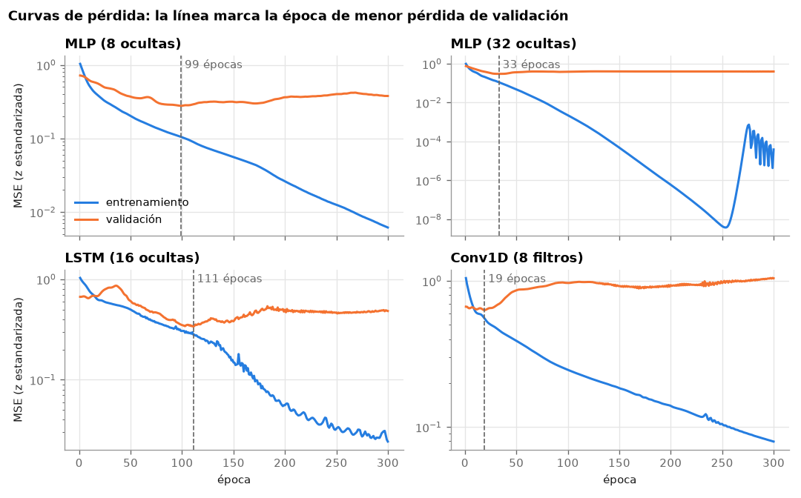
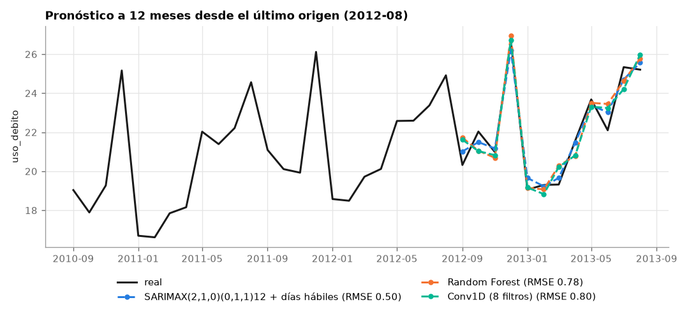
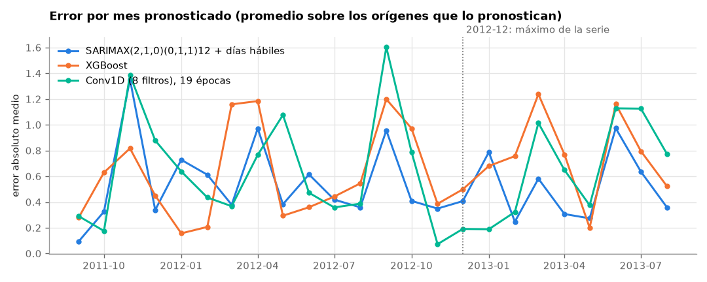

# Informe del miniproyecto 2

**Serie:** uso mensual de tarjetas débito en Islandia, 2000-01 a 2013-08.
Todas las cifras salen de lo que imprime `python miniproyecto.py` en la
acción de GitHub sobre `main`, y las figuras son las que ese guion deja en
`figuras/`. Las tablas completas quedan en `resultados/`.

## 1. La serie y el modelo a superar

La serie mide el **valor mensual de las compras con tarjeta débito en el
comercio minorista de Islandia**, en millones de coronas islandesas (ISK) a
precios corrientes, según Statistics Iceland (copia del conjunto `debitcards`
del paquete de R `fpp2`). Es **mensual**, va de **enero de 2000 a agosto de
2013** y tiene **164 observaciones**, sin meses vacíos; va de 7.204 (2000-01)
a 26.675 (2012-12). La ficha está en [`datos/README.md`](../datos/README.md).
Es la misma serie del miniproyecto 1.

**Huecos y atípicos: la decisión del miniproyecto 1.** La serie no trae meses
vacíos; si los trajera, `preparar` los rellenaría por **interpolación lineal
en el tiempo**. Los atípicos se detectan con el residuo $R_t$ de una STL
robusta: un mes es atípico si

$$
|z_t| = \frac{|R_t - \operatorname{mediana}(R)|}{1.4826\,\operatorname{MAD}(R)} > 3 .
$$

El guion marca **10 meses**: cuatro de la crisis bancaria de 2008 (junio,
julio, agosto y noviembre, todos negativos), cuatro con más o menos días
hábiles de lo normal (2004-05, 2006-03, 2007-10 y 2010-03) y dos meses altos
de 2011 (agosto, $z = +3.4$, y septiembre, $z = +4.1$). **Se conservan sin
cambios**: son meses que ocurrieron, no errores de captura, y el *backtest*
debe medir los modelos con los datos tal como ocurrieron. El efecto del
calendario no se borra: se modela con los días hábiles.

**El modelo a superar** es el mejor del miniproyecto 1, el
SARIMAX$(2,1,0)(0,1,1)_{12}$ con los días hábiles del mes como exógena. Es una
regresión con errores SARIMA:

$$
y_t = \beta\, x_t + u_t, \qquad
(1 - \phi_1 B - \phi_2 B^2)(1 - B)(1 - B^{12})\,u_t = (1 + \Theta_1 B^{12})\,\varepsilon_t,
\qquad \varepsilon_t \sim \text{RB}(0, \sigma^2),
$$

donde $B$ es el operador de rezago y $x_t$ es el número de días hábiles del
mes en Islandia (lunes a viernes que no son festivo oficial) menos 21. En cada
origen del *backtest* el modelo se vuelve a estimar con los datos hasta el
origen, y pronostica con los días hábiles de los 12 meses siguientes, que
salen del calendario y no de la serie. En el miniproyecto 1 los festivos
venían de la librería `holidays`; aquí se calculan en Python puro y dan los
mismos días hábiles en los 176 meses (de 16 a 23 por mes).

El *backtest* es el mismo de `comun.py`: 13 orígenes, de 2011-08 a 2012-08, y
horizonte de 1 a 12, así que se pronostican los meses de 2011-09 a 2013-08.
En él el SARIMAX da **RMSE 0.64, MAE 0.54 y MAPE 2.56 %**, y el guion imprime
que **coincide con el miniproyecto 1**, también en el RMSE de cada uno de los
13 orígenes. Nada cambió: el cálculo propio de los festivos reproduce la
exógena exacta.

## 2. La tabla supervisada

**Qué aprenden los modelos.** `OBJETIVO = "dif12"`: los modelos no aprenden la
serie $y_t$ sino su diferencia con el mismo mes del año anterior,

$$
z_t = y_t - y_{t-12} .
$$

La serie crece (la tendencia se multiplica por 2.7 entre 2000 y 2013) y su
máximo cae dentro de los meses del *backtest*: antes del *backtest* el máximo
es 25.167 (2010-12) y en él llega a 26.675 (2012-12); **4 de los 24 meses del
*backtest* superan todo lo visto antes**. Un árbol que aprende el nivel no
puede pronosticar por encima de lo que vio al entrenar. La diferencia a 12
quita la estacionalidad (la misma $D = 1$ del SARIMA) y deja una cantidad que
sí se repite en el pasado: $z$ tiene media 1.095 y desviación 1.250, y va de
−2.585 a 4.467. En el experimento del guion, entrenado hasta 2010-08 y
pronosticando de 2010-09 a 2011-08, los 12 meses anteriores al *backtest*,
**Random Forest pasa de RMSE 1.727 con el nivel a 0.910 con la diferencia, y
XGBoost de 1.917 a 0.899**.

**Las columnas.** Cada fila $t$ tiene solo lo que se sabe antes de que $t$
ocurra; ninguna columna usa $z_t$. Son 20 columnas:

- **Rezagos** (`rezago_1` a `rezago_12`):
  $$
  \text{rezago}_k(t) = z_{t-k}, \qquad k = 1, \dots, 12 .
  $$
- **Variables de fecha** (`mes`, `mes_sin`, `mes_cos`): el mes del año
  $m_t \in \{1, \dots, 12\}$ y su posición en el círculo, para que diciembre y
  enero queden cerca en KNN, SVR y el MLP:
  $$
  \text{mes\_sin}(t) = \sin\!\left(\frac{2\pi m_t}{12}\right), \qquad
  \text{mes\_cos}(t) = \cos\!\left(\frac{2\pi m_t}{12}\right).
  $$
- **Ventanas móviles** (`media_3`, `media_12`, `desv_12`), sobre $z$ corrida
  un mes, es decir, desde $z_{t-1}$ hacia atrás:
  $$
  \text{media}_w(t) = \frac{1}{w}\sum_{j=1}^{w} z_{t-j}\quad (w = 3, 12), \qquad
  \text{desv}_{12}(t) = \sqrt{\frac{1}{11}\sum_{j=1}^{12}\bigl(z_{t-j} - \text{media}_{12}(t)\bigr)^2} .
  $$
- **Días hábiles** (`dias_habiles`, `dif_dias_habiles`): los días hábiles del
  mes $t$ centrados en 21, $x_t$, y su diferencia con el mismo mes del año
  anterior, $x_t - x_{t-12}$. Salen del calendario, como la exógena del
  SARIMAX, así que se conocen de antemano.

Las filas con algún vacío se descartan: se pierden los primeros 24 meses, 12
por la diferencia a 12 y 12 por los rezagos. En el primer origen del
*backtest* quedan **116 filas** para entrenar (2002-01 a 2011-08) y en el
último **128**.

**Cómo se prueba que ninguna fila ve el mes que predice.**
`comprobar_sin_fuga` suma 1000 a $y_t$ en cada uno de los 164 meses, uno a la
vez, rearma la tabla y exige que la fila $t$ quede idéntica; si cambia, lanza
un error. El guion imprime que **ninguna fila cambió al alterar su propio
mes**. Para mostrar que la prueba sí detecta algo, cuenta además en cuántos
casos cambia la fila $t+1$, cuyo `rezago_1` lee el mes alterado: **151 de
163** (en los primeros 12 meses $z_t$ no existe, porque la diferencia a 12
necesita el año anterior). Como control negativo, la misma prueba se corre
sobre una tabla con `media_3` sin `shift(1)`, que incluye $z_t$, y **la prueba
falla, como debe**: la fila de 2001-03 cambia al alterar su propio mes.

**El pronóstico recursivo a 12 meses.** El modelo pronostica un mes a la vez.
Para el mes $t+k$ se arma su fila con los datos y los pronósticos anteriores,
se pronostica $\hat z_{t+k}$ y se lleva al nivel con

$$
\hat y_{t+k} = y_{t+k-12} + \hat z_{t+k},
$$

donde $y_{t+k-12}$ es siempre un dato real, porque $h = 12$. Ese
$\hat y_{t+k}$ se escribe como si fuera dato, para que entre como rezago del
mes siguiente.

**Dónde se ajusta el escalador.** En cada origen del *backtest*, `con_tabla`
arma la tabla solo con el entrenamiento de ese origen y ajusta un modelo
nuevo. El escalador vive dentro del modelo, así que también se ajusta en cada
origen y nunca ve los meses que se van a medir:

- KNN, SVR y el MLP estandarizan **cada columna** con su media y su desviación
  en el entrenamiento del origen (un `StandardScaler`):
  $\tilde x_{j} = (x_{j} - \bar x_j)/s_j$.
- La LSTM y la Conv1D reciben solo los 12 rezagos, y los escalan con la
  **media y la desviación del objetivo** en el entrenamiento del origen,
  $\tilde z_{t-k} = (z_{t-k} - \bar z)/s_z$, para que la secuencia y lo que
  predicen queden en las mismas unidades.
- Las tres redes aprenden $\tilde z = (z - \bar z)/s_z$ y devuelven el
  pronóstico en la escala original, $\hat z = s_z\,\hat{\tilde z} + \bar z$.
- Random Forest y XGBoost no escalan: sus cortes no dependen de la escala.

## 3. Aprendizaje automático

**Las rejillas.** Cada modelo prueba de 2 a 4 valores por hiperparámetro:

| Modelo | Rejilla | Combinaciones | Elegido | RMSE de validación |
|---|---|---|---|---|
| KNN | `n_neighbors` ∈ {3, 5, 7, 10} | 4 | `n_neighbors=3` | 1.150 |
| SVR (RBF) | `C` ∈ {0.1, 1, 10}, `epsilon` ∈ {0.01, 0.1, 0.3} | 9 | `C=10`, `epsilon=0.01` | 1.215 |
| Random Forest (100 árboles) | `max_depth` ∈ {3, 5, None}, `min_samples_leaf` ∈ {1, 3, 5} | 9 | `max_depth=None`, `min_samples_leaf=3` | 1.221 |
| XGBoost (200 árboles) | `max_depth` ∈ {2, 3, 5}, `learning_rate` ∈ {0.03, 0.1, 0.3} | 9 | `max_depth=2`, `learning_rate=0.03` | 1.245 |

El RMSE de validación es a un paso y en unidades de $z$ (millones de ISK); la
rejilla completa está en `resultados/rejillas.csv`.

**Con qué datos y qué validación.** `GridSearchCV` con `TimeSeriesSplit(5)`
sobre las **116 filas anteriores al *backtest*** (2002-01 a 2011-08). Cada
pliegue entrena con los meses anteriores y valida con los 19 siguientes; el
entrenamiento crece de 21 a 97 filas y el último pliegue valida de 2010-02 a
2011-08. **Ninguno de los 24 meses del *backtest* participa en la elección**:
la tabla se arma con `serie.iloc[:-24]`. Si participaran, los hiperparámetros
se escogerían mirando los meses con que después se mide el modelo, y su error
en el *backtest* sería optimista.

Tres modelos quedan en el borde de su rejilla: KNN con el menor número de
vecinos, SVR con el mayor `C` y el menor `epsilon`, y XGBoost con la menor
profundidad y la menor tasa. Su óptimo podría estar fuera de lo probado.

**Qué variables pesan más.** En los dos ensambles manda `media_3`, el
promedio de $z_{t-1}$, $z_{t-2}$ y $z_{t-3}$:

| Variable | Random Forest | XGBoost |
|---|---|---|
| `media_3` | 0.260 | 0.218 |
| `rezago_3` | 0.123 | 0.113 |
| `rezago_1` | 0.116 | 0.068 |
| `dif_dias_habiles` | 0.083 | 0.084 |
| `rezago_12` | 0.086 | 0.063 |
| `desv_12` | 0.046 | 0.075 |

La PACF del miniproyecto 1, sobre $(1-B)(1-B^{12})y_t$, era significativa en
los rezagos 1, 2, 11, 12, 13 y 14. Los ensambles toman el 1 y el 12, y el 2
entra a través de `media_3`, que resume la dinámica de corto plazo que el
SARIMAX modela con su AR(2). El `rezago_3` no aparecía en la PACF.
`dif_dias_habiles` está entre las cinco primeras en los dos (quinta en Random
Forest y tercera en XGBoost): es el efecto del calendario que el SARIMAX
recoge con su exógena.

**Resultado en el *backtest*:**

| Modelo | RMSE | MAE | MAPE (%) |
|---|---|---|---|
| XGBoost | 0.82 | 0.67 | 3.17 |
| Random Forest | 0.82 | 0.67 | 3.14 |
| KNN | 0.87 | 0.71 | 3.38 |
| SVR | 0.88 | 0.75 | 3.50 |

**Random Forest y XGBoost empatan** en RMSE (0.82) y MAE (0.67); Random Forest
gana por poco en MAPE (3.14 % frente a 3.17 %). Los cuatro superan al
estacional ingenuo (1.23), pero ninguno al SARIMAX (0.64).

## 4. Aprendizaje profundo

Las tres redes se entrenan en PyTorch con la clase `Red`: Adam con tasa 0.01,
pérdida MSE sobre $\tilde z$ y todas las filas en cada época.

**MLP.** Recibe las 20 columnas de la fila, estandarizadas, como un vector
$\mathbf{x} \in \mathbb{R}^{20}$, con una capa oculta de $n$ neuronas:

$$
\hat{\tilde z} = \mathbf{w}_2^{\top}\,\operatorname{ReLU}(W_1 \mathbf{x} + \mathbf{b}_1) + b_2,
\qquad W_1 \in \mathbb{R}^{n \times 20}.
$$

Tiene $20n + n + n + 1$ parámetros: **177 con 8 ocultas y 705 con 32**.

**LSTM.** Recibe la secuencia de los 12 rezagos, del más viejo al más
reciente, $x_1 = \tilde z_{t-12}, \dots, x_{12} = \tilde z_{t-1}$, con forma
(lote, 12, 1). Una capa LSTM de 16 unidades la recorre con las compuertas

$$
\begin{aligned}
\mathbf{i}_s &= \sigma(W_i x_s + U_i \mathbf{h}_{s-1} + \mathbf{b}_i), &
\mathbf{f}_s &= \sigma(W_f x_s + U_f \mathbf{h}_{s-1} + \mathbf{b}_f), \\
\mathbf{g}_s &= \tanh(W_g x_s + U_g \mathbf{h}_{s-1} + \mathbf{b}_g), &
\mathbf{o}_s &= \sigma(W_o x_s + U_o \mathbf{h}_{s-1} + \mathbf{b}_o), \\
\mathbf{c}_s &= \mathbf{f}_s \odot \mathbf{c}_{s-1} + \mathbf{i}_s \odot \mathbf{g}_s, &
\mathbf{h}_s &= \mathbf{o}_s \odot \tanh(\mathbf{c}_s),
\end{aligned}
$$

con $\mathbf{h}_0 = \mathbf{c}_0 = \mathbf{0}$, y una capa lineal lee el último
estado oculto: $\hat{\tilde z} = \mathbf{w}^{\top}\mathbf{h}_{12} + b$. La
compuerta de olvido $\mathbf{f}$ decide cuánto de la memoria $\mathbf{c}$ se
conserva, la de entrada $\mathbf{i}$ cuánto del candidato $\mathbf{g}$ se
escribe y la de salida $\mathbf{o}$ cuánto de la memoria se muestra. Tiene
$4(16 + 16 \cdot 16 + 2 \cdot 16) + 17 =$ **1233 parámetros** (PyTorch usa dos
vectores de sesgo por compuerta).

**Conv1D, la tercera red.** Recibe la misma secuencia que la LSTM. Ocho
filtros de tamaño 3 recorren los 12 meses:

$$
a_{f,s} = \operatorname{ReLU}\!\left(b_f + \sum_{j=0}^{2} w_{f,j}\, x_{s+j}\right),
\qquad f = 1, \dots, 8,\quad s = 1, \dots, 10,
$$

y una capa lineal combina los $8 \times 10 = 80$ valores:
$\hat{\tilde z} = \sum_{f,s} v_{f,s}\, a_{f,s} + c$. Tiene
$8 \cdot 3 + 8 + 80 + 1 =$ **113 parámetros**. La elegimos por dos razones:
con 116 a 128 filas de entrenamiento tiene diez veces menos parámetros que la
LSTM, y un filtro de 3 meses mira la misma dinámica de corto plazo que el
AR(2) del SARIMAX y que la `media_3` que más pesa en los ensambles.

La LSTM y la Conv1D solo ven los 12 rezagos: no reciben el mes ni los días
hábiles, que el MLP sí recibe.

**Cómo se eligen las épocas.** La tabla se arma con los meses anteriores al
*backtest*: las primeras **104 filas** (2002-01 a 2010-08) entrenan y las
**12 últimas** (2010-09 a 2011-08) validan. Cada red se entrena 300 épocas y
se toman las épocas de menor pérdida de validación (MSE en unidades de
$\tilde z$):

| Red | Parámetros | Épocas elegidas | Pérdida de validación en esa época | En la época 300 |
|---|---|---|---|---|
| MLP (8 ocultas) | 177 | 99 | 0.277 | 0.378 |
| MLP (32 ocultas) | 705 | 33 | 0.299 | 0.396 |
| LSTM (16 ocultas) | 1233 | 111 | 0.338 | 0.435 |
| Conv1D (8 filtros) | 113 | 19 | 0.631 | 1.034 |

En las cuatro, la pérdida de entrenamiento sigue bajando hasta la época 300
mientras la de validación toca su mínimo y vuelve a subir: ahí empieza el
sobreajuste. La Conv1D sobreajusta primero, desde la época 19. El caso
extremo es el **MLP de 32 ocultas**, que baja la pérdida de entrenamiento a
$10^{-8}$ hacia la época 250 mientras la de validación no se mueve de 0.4: se
aprende las filas de memoria. Por eso **queda el MLP de 8 ocultas**, con
menor pérdida de validación (0.277 frente a 0.299) y la cuarta parte de los
parámetros.

**Resultado en el *backtest*:**

| Red | RMSE | MAE | MAPE (%) |
|---|---|---|---|
| Conv1D (8 filtros), 19 épocas | 0.78 | 0.62 | 2.92 |
| MLP (8 ocultas), 99 épocas | 1.12 | 0.94 | 4.46 |
| LSTM (16 ocultas), 111 épocas | 1.21 | 1.02 | 4.79 |

La validación a un paso no ordena bien a las redes: el MLP tiene la menor
pérdida de validación y la Conv1D la mayor, pero en el *backtest* a 12 meses
la Conv1D es la mejor red (0.78) y el MLP queda en 1.12. La validación mide
un paso con 12 meses; el *backtest* encadena 12 pasos recursivos, y el error
de cada mes entra como rezago del siguiente.

**La Conv1D con cinco semillas** (`resultados/semillas.csv`), cada una por el
*backtest* completo:

| Semilla | 2026 | 2027 | 2028 | 2029 | 2030 |
|---|---|---|---|---|---|
| RMSE | 0.776 | 0.731 | 0.813 | 0.714 | 0.844 |

La media es **0.776** y la desviación **0.055** (`ddof=1`). La distancia con
el SARIMAX, $0.776 - 0.64 = +0.136$, es **mayor que esa desviación** (unas
2.5 veces): la diferencia no se explica por la semilla. Ni la mejor semilla
(0.714) alcanza al SARIMAX.

## 5. La tabla y la elección

`resultados/metricas.csv`, ordenada por RMSE (*backtest* común, 13 orígenes,
horizonte de 1 a 12):

| Modelo | RMSE | MAE | MAPE (%) | Parámetros | Segundos |
|---|---|---|---|---|---|
| SARIMAX$(2,1,0)(0,1,1)_{12}$ + días hábiles | **0.64** | **0.54** | **2.56** | 5 | 2.1 |
| Conv1D (8 filtros), 19 épocas | 0.78 | 0.62 | 2.92 | 113 | 0.9 |
| XGBoost | 0.82 | 0.67 | 3.17 | 1394 | 2.4 |
| Random Forest | 0.82 | 0.67 | 3.14 | 4402 | 2.7 |
| KNN | 0.87 | 0.71 | 3.38 | 2560 | 2.7 |
| SVR | 0.88 | 0.75 | 3.50 | 2668 | 0.7 |
| MLP (8 ocultas), 99 épocas | 1.12 | 0.94 | 4.46 | 177 | 1.5 |
| LSTM (16 ocultas), 111 épocas | 1.21 | 1.02 | 4.79 | 1233 | 3.5 |
| estacional ingenuo | 1.23 | 1.10 | 5.17 | 0 | 0.0 |

Los parámetros son los del último origen; en KNN son los valores que
memoriza, en SVR los vectores de soporte y sus coeficientes, y en los árboles
los nodos. Los segundos son los del *backtest* de cada modelo y cambian un
poco en cada corrida. Las cifras son las de la acción de GitHub (Linux). En
Windows todas coinciden salvo la LSTM, que da RMSE 1.20 y MAPE 4.77 porque
PyTorch redondea distinto; la que vale es la de la acción.

**Ningún modelo supera al SARIMAX.** La mejor red, la Conv1D, queda a 0.14 de
RMSE, y los mejores modelos de aprendizaje automático a 0.18. Lo atribuimos a
tres datos de la serie:

1. **Pocos datos para tantos parámetros.** En el último origen el SARIMAX
   ajusta 5 parámetros con 152 meses: 0.03 por mes. Los modelos de la tabla
   tienen 128 filas: la Conv1D usa 0.88 parámetros por fila, el MLP 1.38, la
   LSTM 9.63, XGBoost 10.9 y Random Forest 34.4. La única red que se acerca
   es la de menos parámetros, y la LSTM, con más de nueve por fila, queda casi
   en el estacional ingenuo. Las curvas de pérdida muestran lo mismo: con 104
   filas, las redes se aprenden el entrenamiento y la validación empeora.
2. **El mes en que fallan.**

   

   La Conv1D, Random Forest y KNN tienen su peor mes en **2012-09**, y los
   tres se pasan: el real fue 20.325 y el error medio de la Conv1D es 1.60.
   Con `dif12`, el pronóstico es $\hat y_{t} = y_{t-12} + \hat z_t$, así que
   el de septiembre de 2012 parte de septiembre de 2011, un atípico alto
   ($z = +4.1$) que decidimos conservar. El SARIMAX también falla ahí (0.96),
   pero menos, y su peor mes es otro: 2011-11 (error 1.35). En cambio, en los
   tres primeros orígenes (2011-08 a 2011-10) varios modelos de la tabla le
   ganan al SARIMAX: Random Forest da 0.53 en el primero frente a 0.86. El
   SARIMAX tiene el menor RMSE en 7 de los 13 orígenes, y la Conv1D le gana
   en 3 (`resultados/rmse_por_origen.csv`).
3. **La variación entre semillas no alcanza.** La distancia de la Conv1D al
   SARIMAX (+0.136) es unas 2.5 veces la desviación entre semillas (0.055), y
   ni la mejor semilla lo alcanza.

## 6. Conclusión

**Pondríamos en uso el SARIMAX$(2,1,0)(0,1,1)_{12}$ con los días hábiles.**
Tiene el menor error en las tres métricas (RMSE 0.64, MAE 0.54, MAPE 2.56 %)
y es el más barato en lo que se paga por un modelo:

- **Datos:** 5 parámetros. Se ajusta con todos los meses hasta el origen (152
  en el último), mientras que los modelos de la tabla pierden los primeros 24
  por la diferencia a 12 y los rezagos (128 filas).
- **Tiempo:** 2.1 s para los 13 ajustes del *backtest*. La Conv1D tarda menos
  en el *backtest* (0.9 s), pero antes hay que elegir sus épocas con
  validación, y su resultado cambia con la semilla (de 0.714 a 0.844).
- **Explicabilidad:** su pronóstico se escribe con la ecuación de la sección
  1. Cada coeficiente se lee: un día hábil más suma unos 0.36 millones de ISK
  al mes (estimación del miniproyecto 1). La Conv1D reparte 113 pesos entre
  ocho filtros y no da esa lectura; los ensambles solo dicen qué variables
  usan más.

La Conv1D es la alternativa de redes más cercana, a 0.14 de RMSE, con 113
parámetros. Valdría la pena volver a ella con más años de datos, o si se
necesitara un modelo que no dependa de elegir a mano los órdenes del SARIMA.
